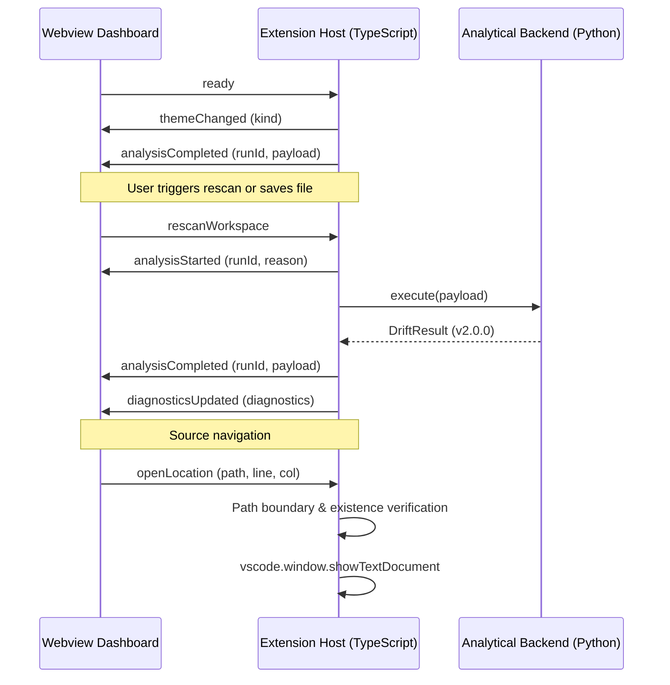

# Technical Architecture Documentation: Drift Extension

## 1. Overview

The **Drift Extension** is a Visual Studio Code extension designed to analyze project source code and detect divergence ("drift") from a user-defined project goal. The solution uses a dual-engine architecture:
- A TypeScript extension host client managing VS Code lifecycle, commands, webview rendering, file discovery, and save debouncing.
- A Python backend running standard library analytical heuristics (AST extraction, domain concept alignment, TF-IDF cosine similarity, risk velocity, and architecture distribution).

---

## 2. Directory Layout & Module Responsibilities

```
drift-extension/
├── src/                          # TypeScript Extension Core
│   ├── commands/                 # Command registrations and handlers
│   │   └── index.ts              # Command controller & delegate bindings
│   ├── providers/                # VS Code Webview & UI providers
│   │   └── webviewPanel.ts       # CSP generation, webview HTML, two-way messaging
│   ├── services/                 # Core extension business logic
│   │   ├── analysisQueue.ts      # Debounced trailing-edge analysis queue
│   │   ├── backendProcess.ts     # Safe Python spawn, timeouts, and IPC cleanup
│   │   ├── fileCollector.ts      # Recursive filesystem crawler with boundaries
│   │   └── sessionManager.ts     # Persistent workspace state manager
│   ├── types/                    # Shared TypeScript interfaces
│   │   └── index.ts              # DriftResult, SessionState, IPC payload schemas
│   ├── utils/                    # Shared utilities
│   │   ├── exclusions.ts         # Canonical directories, extensions, secrets
│   │   └── security.ts           # Nonce generator, workspace boundary checks
│   └── extension.ts              # Extension activation & event listener wiring
├── backend/                      # Python Analytical Backend
│   ├── main.py                   # CLI entry point (argument parsing & stdout output)
│   ├── analyzer.py               # DriftAnalyzer orchestrator & ensemble scorer
│   ├── extractor.py              # File reader, AST parser, token extractor
│   ├── similarity.py             # TF-IDF vectorizer and cosine similarity
│   ├── domain_detector.py        # Import domain mapping & identifier alignment
│   ├── area_analysis.py          # Code distribution heuristic (UI / Backend / Logic)
│   ├── risk.py                   # Score volatility and trend velocity predictor
│   ├── drift.py                  # Threshold classifier (Aligned / Drifting / Danger)
│   ├── suggestion.py             # Action plan and recommendation generator
│   ├── services/                 # Auxiliary backend services
│   └── utils/
│       └── exclusions.py         # Canonical exclusion policies in Python
├── webview/                      # Webview Dashboard UI
│   ├── panel.html                # Dashboard layout with strict CSP meta tag
│   ├── panel.js                  # Frontend state renderer & SVG trendline
│   └── style.css                 # Dark theme responsive stylesheet
├── tests/                        # Comprehensive Test Suites
│   ├── extension/                # Node/TypeScript integration tests
│   │   ├── analysisQueue.test.ts # Debounce and trailing-edge queue tests
│   │   ├── backendProcess.test.ts# Process timeout, cancellation, error tests
│   │   └── fileCollector.test.ts # Exclusions, secrets, and boundary tests
│   ├── backend/                  # Python unit tests
│   │   ├── test_analyzer.py      # End-to-end analyzer tests
│   │   ├── test_exclusions.py    # Canonical exclusion tests
│   │   ├── test_extractor.py     # AST parser & file discovery tests
│   │   └── test_similarity.py    # Vectorizer and tokenizer tests
│   └── fixtures/                 # Sample test payloads
│       ├── sample-payload.json
│       └── sample-payload-friendly.json
├── data/
│   └── config.json               # Configurable thresholds and entrypoints
├── docs/
│   ├── PROJECT_AUDIT.md          # Comprehensive audit and gap analysis
│   └── ARCHITECTURE.md           # This document
├── package.json                  # Extension manifest & scripts
├── tsconfig.json                 # TypeScript build configuration
├── tsconfig.test.json            # TypeScript test configuration
├── requirements.txt              # Standard library note
├── .gitignore                    # Git exclusions
├── .vscodeignore                 # VS Code extension packaging exclusions
└── README.md                     # User and developer guide
```

---

## 3. Inter-Process Communication (IPC) & Security

### 3.1 Direct Execution Without Shell Wrappers
Previously, `child_process.spawn` was executed with `shell: true` on Windows, which exposed the process to shell metacharacter injection if file paths contained spaces or special symbols. In the refactored architecture:
- `shell: false` is strictly enforced.
- The Python executable and backend script paths are resolved explicitly.
- Arguments are passed as an isolated array `[backendScriptPath, '--payload', tempPayloadPath]`.

### 3.2 Ephemeral Temp Directories & Isolation
1. Before every execution, a cryptographically unique directory is created using `fs.mkdtemp(path.join(os.tmpdir(), 'drift-run-'))`.
2. The payload JSON is written with restrictive read/write permissions (`0o600`).
3. Execution is enclosed in a `try...finally` block that removes the temporary folder via `fs.rm(tempDir, { recursive: true, force: true })`, ensuring zero disk leakage even on process crashes.

### 3.3 Configurable Timeout & Cancellation
- The backend process is monitored by a configurable timer (`driftDetection.backendTimeout`, defaulting to 15,000ms).
- If the timeout expires or a cancellation is requested via command or extension deactivation:
  1. The child process receives `SIGTERM`.
  2. If the process does not terminate within 1,000ms, it is escalated to `SIGKILL`.
  3. The promise rejects with a clean `Error` message.

---

## 4. Concurrency & The Trailing-Edge Save Queue

### The Race Condition Problem
In the initial prototype, when a developer saved a file while an analysis was already in progress, the save event was dropped because `isAnalyzing` was true. Edits made during that scan were permanently ignored until another manual save.

### The Trailing-Edge Queue Solution
The `AnalysisQueue` service introduces a coalescing trailing-edge queue:
1. **Debounce (400ms):** Rapid keystrokes or multiple file saves within 400ms are coalesced into a single scheduled trigger.
2. **Execution Check:**
   - If `isAnalyzing == false`: The queue immediately executes the analysis.
   - If `isAnalyzing == true`: The queue records a `pendingRequest = { reason }`.
3. **Trailing Dispatch:** When the active analysis finishes (whether successful or failed), `finally` checks `pendingRequest`. If a pending save was recorded, it immediately launches a new analysis with the freshest workspace state.
4. **Stale Result Prevention:** Each analysis receives a monotonic `runId`. If an older asynchronous run resolves after a newer run has already been initiated, its result is discarded.

---

## 5. Webview Security & Content Security Policy (CSP)

The webview dashboard is isolated under a restrictive CSP:
```html
<meta http-equiv="Content-Security-Policy" content="default-src 'none'; style-src ${webview.cspSource} 'unsafe-inline'; script-src 'nonce-${nonce}'; img-src ${webview.cspSource} data:; font-src ${webview.cspSource};">
```

Key security mechanisms:
- **Cryptographic Nonce:** Every webview load generates a fresh 128-bit cryptographic nonce (`crypto.randomBytes(16).toString('hex')`) injected into the script tag.
- **Resource Restriction:** Only local assets within the extension's `/webview` directory can be loaded via `webview.asWebviewUri`.
- **Path Traversal Shield:** Webview-to-extension messages requesting file opening (`action:openFile`) are verified using `isPathInsideDirectory()`. The extension refuses to open any path resolving outside the workspace root.

---

## 6. Canonical Exclusion Policy

Both TypeScript and Python layers share a single canonical exclusion policy:
- **Directories:** `.git`, `.svn`, `.hg`, `node_modules`, `bower_components`, `vendor`, `dist`, `build`, `out`, `target`, `bin`, `obj`, `.next`, `.nuxt`, `.turbo`, `.cache`, `.venv`, `venv`, `env`, `__pycache__`, `.pytest_cache`, `.mypy_cache`, `.tox`, `coverage`, `.nyc_output`, `.idea`, `.vs`.
- **File Extensions:** Binary executables (`.exe`, `.dll`, `.so`, `.bin`), archives (`.zip`, `.tar`, `.gz`, `.7z`), media (`.png`, `.jpg`, `.mp4`, `.mp3`, `.pdf`), fonts (`.woff`, `.woff2`, `.ttf`), compiled bytecode (`.pyc`, `.class`), maps and locks (`.map`, `.lock`).
- **Secrets & Credentials:** `.env`, `.env.*`, `*.pem`, `*.key`, `*.cert`, `id_rsa`, `id_ed25519`, `credentials.json`, `secrets.json`.
- **File Size Limit:** Files exceeding 1MB (1,048,576 bytes) are skipped to protect memory.
- **Directory Symlinks:** Resolved and cycle-checked to prevent infinite recursive loops.

---

## 7. AI Drift Analysis Engine (v2.0.0)

### 7.1 Multi-Signal Ensemble Scoring Methodology
The drift analysis engine combines five normalized, non-correlated signals:
$$\text{Alignment} = 0.20 \cdot \text{LexicalSim} + 0.20 \cdot \text{IdentifierAlignment} + 0.15 \cdot \text{ImportDomain} + 0.25 \cdot \text{FeatureCoverage} + 0.10 \cdot \text{StructuralRichness} + 0.10 \cdot \text{Completion}$$

$$\text{Drift Score} = 1.0 - \text{Alignment Score}$$

Where:
1. **LexicalSim ($0.20$):** TF-IDF cosine similarity between goal/description and workspace source documents.
2. **IdentifierAlignment ($0.20$):** Semantic presence of goal concepts in function, class, and variable names.
3. **ImportDomain ($0.15$):** Alignment between imported third-party libraries and technical domains implied by the goal.
4. **FeatureCoverage ($0.25$):** Dynamic requirement coverage ($\frac{\text{Implemented} + 0.5 \cdot \text{Partial}}{\text{Total Reqs}}$).
5. **StructuralRichness ($0.10$):** Volume of actual logic and symbol density.
6. **Completion ($0.10$):** Detection of manifests, entrypoints, READMEs, and test suites.

### 7.2 Classification Thresholds
- **Aligned:** $\text{Alignment} \ge 0.65$ and $\text{FeatureCoverage} \ge 0.50$.
- **Drifting:** $0.38 \le \text{Alignment} < 0.65$.
- **Danger:** $\text{Alignment} < 0.38$.
- **Insufficient Evidence:** Workspace contains zero eligible files or trivial implementation volume.

### 7.3 Dynamic Requirements & Stub Verification
- Requirement phrases are dynamically derived from the user's objective without hardcoded catalogs.
- Symbols matching requirements undergo deterministic AST inspection to distinguish functional implementations from empty stubs (`pass`, `...`, `raise NotImplementedError`, `return null`). Stubs alone cannot mark a feature as completed.

### 7.4 Multi-File Syntax Diagnostics
- Evaluates syntax trees across all source files independently without terminating analysis prematurely.
- Reports exact line numbers, columns, error messages, and context code snippets.

---

## 8. Supported Languages & Analysis Capability Levels

| Language | Analysis Level | Method | Capabilities |
|---|---|---|---|
| **Python** | `ast_full` | Standard library `ast` | Full AST traversal, function/class extraction, stub detection, route decorators, multi-file syntax errors |
| **TypeScript / JavaScript** | `structural_regex` | Structural Regex / Lexer | Function/class identification, Express/Node route matching, imports extraction, syntax warnings |
| **Go / Rust / Java / C#** | `structural_regex` | Structural Pattern Matching | Package/import extraction, symbol identification, structural richness scoring |
| **Other Languages** | `basic_scanner` | Line & Token Scanner | Word tokenization, comment filtering, vocabulary similarity |

---

## 9. Comprehensive Analysis Methodology Reference

For deep architectural formulas, morphological normalization algorithms, AST verification procedures, and empirical test results, refer to the dedicated [Analysis Methodology Specification](file:///d:/VSCode/drift-extension/docs/ANALYSIS_METHODOLOGY.md).

---

## 10. Interactive Webview UX & Two-Way Messaging Protocol

### 10.1 Two-Way Messaging Architecture
The dashboard runs in an isolated VS Code Webview with a strict Content Security Policy (`script-src 'nonce-...'`). Communication with the extension host is strictly typed and validated against discriminated unions:



### 10.2 Supported Message Contracts
- **Webview to Host:**
  - `ready`: Notifies extension host to hydrate session and report active theme.
  - `rescanWorkspace`: Triggers an immediate, fresh analysis through the queue.
  - `pauseAnalysis` / `resumeAnalysis`: Pauses or resumes automatic re-analysis triggered by document saves.
  - `updateGoal`: Updates project goal and implementation description, triggering re-scan.
  - `openLocation`: Opens a source file at specified line and column with range reveal.
  - `refreshDashboard`: Re-renders current cached state without re-running Python.
- **Host to Webview:**
  - `analysisStarted`, `analysisProgress`, `analysisCompleted`, `analysisFailed`.
  - `analysisPaused`, `analysisResumed`.
  - `diagnosticsUpdated`, `goalUpdated`, `themeChanged`.

### 10.3 Security & Boundary Verification
All file opening requests originating from the Webview are strictly checked:
1. Relative paths are resolved against `session.rootPath`.
2. Paths are checked with `isPathInsideDirectory` to guarantee they do not escape the workspace via traversal (`..`) or symbolic links.
3. Target file existence is validated prior to opening; non-existent files yield a non-crashing warning.
4. Line and column numbers are clamped to the document's actual line count and text length.

### 10.4 Native Theme Alignment
The Webview styling adapts natively to VS Code themes using CSS custom properties (`--vscode-editor-background`, `--vscode-button-background`, `--vscode-focusBorder`, etc.), with full support for Light, Dark, High-Contrast modes, accessible focus indicators, and reduced-motion preferences.

