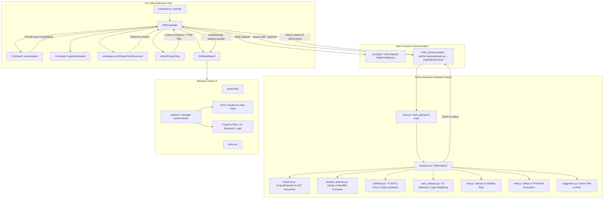

# Comprehensive Project Audit and Technical Architecture Report: Drift Extension

**Project Name:** Live Code Drift Detection AI (`drift-extension`)  
**Audit Date:** October 17, 2026  
**Auditor:** Senior Software Architect, TypeScript & Python Specialist  
**Workspace:** `d:\VSCode\drift-extension`  
**Execution Environment:** Windows (PowerShell), Python 3.14.2, Node.js v24.14.0, npm 11.9.0, VS Code Extension API ^1.85.0  

---

## 1. Executive Summary

The **Drift Extension** is a developer assistance tool for Visual Studio Code designed to detect semantic and structural divergence between an engineer's stated project goal and the code actually being implemented in the workspace.

### Core Strengths
- **Clean Standard-Library Python Backend:** The backend runs entirely on Python's standard library (`ast`, `re`, `json`, `difflib`, `math`, `collections`, `pathlib`), requiring zero external pip dependencies (`requirements.txt` is minimal and lightweight).
- **Multi-Signal Heuristic Ensemble:** The backend combines TF-IDF vocabulary similarity, library import concept mapping, AST identifier matching, structural code richness, and file completion signals to arrive at an ensemble drift score.
- **Custom Native Webview:** Visualizes drift score, AI action plan, code area distribution (UI / Backend / Logic), trend history SVG curve, readiness level, and error detection without external frontend framework bloat.
- **Automatic Save Trigger:** Listens for document saves in VS Code to trigger automated re-analysis.

### Critical Weaknesses & Vulnerabilities
1. **Severe Hackathon Overfitting & Hardcoded Domain Bias:** The similarity engine, feature catalog, and guardrails are heavily hardcoded to a single demo project ("Touchfree gesture computer control with OpenCV/MediaPipe/PyAutoGUI"). If a user runs this on a React app, Django backend, Rust CLI, or Go microservice, the analyzer makes skewed assumptions or yields inaccurate classifications.
2. **Brittle One-Shot IPC with Security Flaws:** Spawns a new Python process on every save with `shell: process.platform === 'win32'`. This poses shell injection risks with unescaped Windows paths, lacks process timeout protection (a hanging Python process locks analysis indefinitely), and incurs high process cold-start overhead.
3. **Save-Debounce Concurrency Race Condition:** If an analysis is currently running when a file is saved, the event is immediately discarded (`if (this.isAnalyzing) return;`), meaning subsequent edits are never analyzed until another save occurs.
4. **Zero State Persistence:** Project goal and description are stored solely in volatile extension memory (`SessionState`). Closing VS Code, switching windows, or reloading the window completely wipes the configured goal.
5. **Non-Interactive Webview & Missing VS Code Integrations:** The webview is purely read-only. Clicking on detected files or error lines does not open them in the VS Code editor. There is no in-dashboard ability to edit the goal, pause auto-analysis, or refresh manually.
6. **No Automated Test Suite, Git Repository, or Documentation:** The workspace lacks a test suite, CI config, git repository, `.gitignore`, and project `README.md`.

---

## 2. Architecture and Data Flow

### 2.1 Component Architecture



### 2.2 Data Contract / Schema

The TypeScript extension and Python backend communicate via a strictly structured JSON payload and response.

#### Extension -> Backend Payload Schema (`payload.json`):
```json
{
  "projectRoot": "string (absolute path)",
  "goal": "string (user primary objective)",
  "description": "string (optional implementation details)",
  "history": [ "number (past scores, max 20 entries)" ],
  "filePaths": [ "string (absolute file paths collected by extension)" ]
}
```

#### Backend -> Extension Result Schema (`DriftResult`):
| Field | Type | Description |
|---|---|---|
| `score` | `number` (0.0 - 1.0) | Ensemble drift alignment score |
| `status` | `'Aligned' \| 'Drifting' \| 'Danger'` | Classification category |
| `reason` | `string` | Primary drift justification |
| `why` | `string` | Synthesized explanation of drift factors |
| `mentor_brief` | `string` | High-level summary text for developer guidance |
| `project_summary` | `string` | Detected architecture and key files summary |
| `suggestion` | `string` | Top recommended action |
| `suggestions` | `string[]` | Ordered list of suggestions |
| `action_plan` | `string[]` | Concrete next steps |
| `risk` | `string` | Risk description |
| `risk_level` | `'Low' \| 'Medium' \| 'High'` | Qualitative risk level |
| `area` | `{ UI: number, Backend: number, Logic: number }` | Percentage distribution across architecture domains |
| `area_details` | `Array<{ path: string, area: string, weight: number }>` | Top contributing files by domain |
| `architecture` | `{ type: string, languages: string[], primary_files: string[], dominant_area: string }` | Architecture classification |
| `feature_map` | `Array<{ feature: string, status: string, evidence: string[] }>` | Detected feature implementations |
| `strengths` | `string[]` | Positive aspects of the implementation |
| `readiness` | `{ level: string, summary: string, signals: string[] }` | Production / execution readiness |
| `confidence` | `number` (0.0 - 1.0) | Heuristic confidence |
| `error_fix` | `{ issue: string, fix: string, file: string, line: string, bad_code: string, fixed_code: string }` | Detected syntax or structural error |
| `graph` | `number[]` | Updated rolling score history (max 20 points) |
| `top_matches` | `Array<{ path: string, score: number }>` | Files most aligned with goal |
| `file_reviews` | `Array<{ path: string, summary: string, alignment: string }>` | Summary reviews of primary files |
| `file_count` | `number` | Count of scanned files |
| `missing_terms` | `string[]` | Unmatched goal keywords |
| `completion_score` | `number` | Structural completeness score |
| `coverage_score` | `number` | Keyword coverage score |
| `completion_notes` | `string[]` | Explanatory notes on completeness |

---

## 3. Detailed Audit of Core Functionality (15 Specific Areas)

### 1. VS Code Extension Activation & Command Registration
- **Current State:**
  - `package.json` contributes two commands: `driftDetection.startAnalysis` and `driftDetection.openDashboard`.
  - Context menu entry registered in explorer (`explorerResourceIsFolder`).
  - Configuration properties contributed: `driftDetection.pythonPath`, `driftDetection.autoAnalyzeOnSave`, `driftDetection.maxFiles`.
- **Gaps & Bugs:**
  - `startAnalysis` accepts `uri?: vscode.Uri`. When triggered from Explorer without a folder selected or from Command Palette in a multi-root workspace, it defaults blindly to `vscode.workspace.workspaceFolders?.[0]?.uri`.
  - If a user opens the dashboard before starting analysis, `session` is undefined; the dashboard renders an empty "Waiting" state with 0% score and offers **no user action** (no "Select Folder" or "Set Goal" button inside the webview).
  - No commands to: "Edit Project Goal", "Stop Analysis", "Clear Drift History", or "Re-run Drift Scan".

### 2. Project-Folder Selection & Project-Goal Configuration
- **Current State:**
  - Sequential `vscode.window.showInputBox` modals query for Goal and Description.
- **Gaps & Bugs:**
  - **No Persistence:** Goals are stored solely in `DriftController.session` (in-memory). Closing VS Code or reloading window erases the goal.
  - No workspace file support (e.g., reading `.drift/goal.md` or `.vscode/drift.json`).
  - Cannot edit the goal without re-triggering folder selection and starting a full new scan.
  - Multi-line descriptions are difficult to enter in a standard single-line `showInputBox`.

### 3. Recursive Source-Code Extraction & File Exclusions
- **Current State:**
  - Handled in two places: `extension.ts:collectProjectFiles` (TypeScript `fs/promises`) and `backend/extractor.py:ProjectExtractor.collect_files` (Python `pathlib.Path.rglob`).
- **Gaps & Bugs:**
  - **Logic Duplication & Inconsistency:** The exclusion lists in TypeScript (`extension.ts` lines 251-256) and Python (`data/config.json`) do not match! For example, `extension.ts` filters `.map`, `.woff`, `.woff2`, `.ttf`, `.eot`, but `data/config.json` does not.
  - **Double Filtering:** TypeScript crawls the filesystem, filters files, writes the list to temp payload, and then Python's `extractor.py` re-filters the paths against `config.json`.
  - **Hard Truncation at 500 Files:** The directory walk stops immediately when reaching `maxFiles` (500). If a project has 501 files, entire subdirectories may be skipped depending on filesystem traversal order.
  - **Unbounded Memory Ingestion:** Python's `file_path.read_text()` reads entire files into memory. If a large generated bundle, database dump, or log file is included, memory spikes significantly.

### 4. Save-Triggered Live Analysis
- **Current State:**
  - `vscode.workspace.onDidSaveTextDocument` triggers `handleSave()`. Debounced by 400ms.
- **Gaps & Bugs:**
  - **Dropped Save Race Condition:** If an analysis takes 1.5 seconds and the developer saves a file at 1.0 second, `if (this.isAnalyzing) return;` silently discards the save. There is no queueing or trailing execution.
  - **Intrusive Notification UI:** Every save triggers `vscode.window.withProgress({ location: vscode.ProgressLocation.Notification, ... })`, popping a modal notification in the bottom right corner of VS Code on every file save. This is intrusive during active coding.
  - **Zero Incremental Caching:** Every save triggers a full re-read, re-AST-parsing, and re-tokenization of all files in the project.

### 5. Goal-versus-Code Similarity
- **Current State:**
  - Custom TF-IDF vectorizer + Cosine similarity in `backend/similarity.py`.
- **Gaps & Bugs:**
  - **Extreme Hackathon Overfitting:**
    - `PHRASE_EXPANSIONS` hardcodes gesture-control concepts: `"touch free" -> "gesture cursor click scroll zoom..."`, `"hand gesture" -> "gesture hand finger landmark..."`, `"webcam" -> "camera webcam frame cv2..."`.
    - `SYNONYM_MAP` maps `"camera" -> "webcam"`, `"touchfree" -> "touch"`.
    - `STOP_WORDS` includes general developer verbs like `"build"`, `"project"`, `"application"`, `"system"`, `"create"`.
  - **Skewed for General Software:** If analyzing a Fintech app, an e-commerce platform, or a DevOps CLI, these expansions do not trigger, while legitimate keywords like "system" or "application" are discarded.
  - **Small-Corpus TF-IDF Distortion:** In projects with few files, IDF produces distorted weights (alleviated partially by adaptive weighting in `analyzer.py`, but fundamentally limited).

### 6. Feature Completion & Missing-Component Detection
- **Current State:**
  - Uses `FEATURE_CATALOG` in `analyzer.py` (9 hardcoded features: gesture_control, computer_control, vision_pipeline, real_time_loop, screenshot_capture, desktop_commands, ui_surface, api_service, data_layer).
- **Gaps & Bugs:**
  - Cannot detect project-specific features outside this narrow list. For instance, authentication, database migrations, unit testing, payment gateways, or routing are either missing or mapped poorly.
  - **Stemming Bug in `similarity.py`:** `LIGHT_STEMS = ("ing", "ed", "es", "s")` slices suffixes naively without checking morphological roots. Example verified during testing: `"mapping"` becomes `"mapp"`! This appears in the UI as: `"Make these ideas easier to see in the code: mapp"`.

### 7. Drift Score & Classification (Aligned / Drifting / Danger)
- **Current State:**
  - Calculated via `compute_ensemble_score()` combining TF-IDF similarity, library import alignment, feature alignment, identifier matching, structural richness, and completeness.
  - Classified in `drift.py:determine_drift()` using thresholds (`alignedThreshold: 0.62`, `driftingThreshold: 0.38`).
- **Gaps & Bugs:**
  - **Hardcoded Guardrail Override:** `analyzer.py` lines 286-296:
    ```python
    if architecture.get("type") == "Real-time Vision Control Engine" and status == "Drifting":
        return "Aligned", "Main features match the goal well.", ...
    ```
    This directly forces any "Real-time Vision Control Engine" project to jump from "Drifting" to "Aligned". This bias must be eliminated in favor of generalized mathematical heuristics.

### 8. Root-Cause Explanations & Recommendations
- **Current State:**
  - Formatted in `build_why_drift()`, `build_action_plan()`, `build_suggestions()`, `build_mentor_brief()`.
- **Gaps & Bugs:**
  - Recommendations can be repetitive and generic: e.g. "A README or docs file is present.", "The project is large enough to show real work."
  - Lacks actionable code snippets or direct file references with line numbers for guidance.

### 9. Syntax Errors & Error-Fix Suggestions
- **Current State:**
  - `analyzer.py:detect_error_fix()` scans TS/JS files for assignment-in-condition (`ASSIGNMENT_IN_CONDITION` regex).
  - Scans Python files using `ast.parse()`.
- **Gaps & Bugs:**
  - **Single Error Limitation:** Halts at the first error in the first file and returns; all subsequent errors across the project are hidden.
  - **Brittle Regex Fix:** In TS/JS, `bad_line.replace("=", " === ", 1)` replaces the first `=` even if it is part of a variable declaration, arrow function, or string literal.
  - No diagnostics for Python type errors, missing imports, unhandled promises, or lint errors.

### 10. UI, Backend, and Logic Classification
- **Current State:**
  - `area_analysis.py:analyze_areas()` counts keyword hits in paths and semantic text, weighted by symbols and line count.
- **Gaps & Bugs:**
  - Heuristic can misclassify core logic as UI. In testing, `cursor_control.py` was categorized as `UI` (weight 261) merely because terms like `screen` or `window` appeared in mouse positioning formulas.
  - Rounding errors: `round((share / total) * 100)` for UI, Backend, and Logic can sum to 99% or 101%.

### 11. Architecture and File Intelligence
- **Current State:**
  - `summarize_architecture()` detects 4 fixed types: "Real-time Vision Control Engine", "UI-led Interactive Application", "Backend-heavy Service Application", or "Hybrid Application".
- **Gaps & Bugs:**
  - Only Python files receive AST parsing (`extract_python_semantics`). TypeScript, JavaScript, Go, C#, HTML, and CSS are parsed only with generic regular expressions (`SYMBOL_PATTERN`, `COMMENT_PATTERN`).

### 12. Risk Assessment
- **Current State:**
  - `risk.py:predict_risk()` inspects drift status, score level, and score derivative (velocity) over the last 4 runs.
- **Gaps & Bugs:**
  - High risk is tied strictly to `status == "Danger" or score < 0.32`.
  - Velocity threshold `-0.05` is sensitive to initial file additions and deletions.

### 13. Dashboard Charts, Score History, and Real-Time Updates
- **Current State:**
  - Webview panel rendered using `extension/webview/panel.html`, `style.css`, and `panel.js`.
  - SVG trendline dynamically draws cubic/linear Bézier path with gradient area fill.
- **Gaps & Bugs:**
  - **Completely Static / Read-Only:** Clicking on a file in "Strongest Matching Files", "File Review", or "Error + Fix" does nothing. It does not navigate to or highlight the file in the VS Code editor.
  - **Theme Incompatibility:** Uses hardcoded `#0e1117` dark background; does not adapt to VS Code's native theme tokens (`--vscode-editor-background`, `--vscode-foreground`).
  - **Trend History Discarded on Close:** The graph points array exists only in volatile memory.

### 14. Python Backend Startup, Process Communication, and Shutdown
- **Current State:**
  - `extension.ts:executeBackend()` writes temporary JSON file to `os.tmpdir()`, spawns `python backend/main.py --payload <temp>`, awaits stdout, and parses JSON.
- **Gaps & Bugs:**
  - **Windows Shell Execution Risk:** `spawn(command, args, { cwd, windowsHide: true, shell: process.platform === 'win32' })` uses the Windows shell (`cmd.exe`), which is susceptible to path escaping issues if workspace or temp paths have spaces, ampersands, or quotes.
  - **No Timeout Protection:** If Python hangs (e.g. infinite loop, file lock, or hung AST parse), the child process remains running indefinitely, blocking the extension permanently.
  - **High Process Overhead:** Spawning a new Python interpreter on every keystroke/save causes unnecessary CPU churn and cold-start latency.

### 15. Input Validation, Security, Performance, and Recovery
- **Current State:**
  - Output channel "Drift AI" logs stderr.
  - Try/catch blocks in TypeScript and Python wrap analysis failures.
- **Gaps & Bugs:**
  - **Missing Content Security Policy (CSP):** `panel.html` does not include a `<meta http-equiv="Content-Security-Policy">` tag.
  - **Insecure Temp File Naming:** `drift-analysis-${Date.now()}.json` uses a predictable timestamp in the shared OS temp folder rather than a secure cryptographically random filename.
  - **Crash Recovery:** If Python returns invalid JSON or crashes, the extension alerts the user but leaves the dashboard in its previous stale state without an explicit error indicator banner.

---

## 4. Categorized Audit Findings & System Inventory

### 4.1 Existing Working Features
- [x] TypeScript extension compiles cleanly (`tsc -p ./` exits 0).
- [x] Python backend runs successfully with standard library on Python 3.14 (`main.py --payload <file>` exits 0).
- [x] Command registration for `driftDetection.startAnalysis` and `driftDetection.openDashboard`.
- [x] Explorer context menu integration (`when: explorerResourceIsFolder`).
- [x] Status bar item with real-time score display and icon status updates.
- [x] Output channel creation ("Drift AI") logging backend stderr.
- [x] Webview panel generation with secure nonce script execution.
- [x] Dynamic SVG trendline rendering with historical data points.
- [x] Multi-signal scoring engine combining TF-IDF, imports, identifiers, and structural metrics.
- [x] Temp file cleanup in `finally` block.

### 4.2 Partially Implemented Features
- [!] **Save-triggered analysis:** Works, but drops events during active analysis and pops intrusive progress modals on every save.
- [!] **Syntax Error Detection:** Only detects assignment in conditions for JS/TS and syntax errors for Python. Ignores all other languages and subsequent errors.
- [!] **Code Area Classification:** Works via keyword counting, but misclassifies logic files as UI when display-related words appear.
- [!] **Feature Mapping:** Works via keyword matching, but restricted to 9 hardcoded gesture-control features.

### 4.3 Broken Features
- [x] **Light Stemming in Tokenizer:** Breaks English words (e.g., `"mapping"` -> `"mapp"`, `"settings"` -> `"setting"`), corrupting missing terms and suggestion lists.
- [x] **Explorer Context Command on Files:** Command only shows up for folders; cannot right-click inside a workspace file or blank area to analyze.
- [x] **Empty Dashboard State:** Opening dashboard before analysis shows dead UI with no interactive call to action.

### 4.4 Missing Features
- [ ] **Goal Persistence:** Storing goal/description in workspace storage (`.vscode/settings.json` or `.drift/config.json`).
- [ ] **Interactive Webview Controls:** "Edit Goal", "Trigger Scan", and clickable file paths that open the file in the editor (`vscode.open`).
- [ ] **General Domain Support:** Configurable feature taxonomies beyond vision/gesture projects.
- [ ] **Process Timeout & Cancellation:** `AbortController` / timeout support for the Python child process.
- [ ] **Automated Tests:** Unit tests for Python backend modules and TypeScript extension integration tests.
- [ ] **Project Documentation & Manifest Metadata:** Missing `README.md`, `.gitignore`, repository URL, and license.

### 4.5 Unnecessary or Temporary Files
- `debug.log`: Chromium/Electron crashpad log created during local VS Code debugging. Should be removed and added to `.gitignore`.
- `sample-payload.json` & `sample-payload-friendly.json`: Temporary testing payloads currently stored in root. Should be relocated to a dedicated `test/fixtures/` directory.

### 4.6 Critical Bugs and Causes Matrix

| ID | Issue | Root Cause | Impact |
|---|---|---|---|
| **BUG-01** | Save events dropped during active scans | `DriftController.runAnalysis` drops execution if `this.isAnalyzing` is true | Saves made during analysis are permanently ignored |
| **BUG-02** | Stemming corruption (`mapp`, etc.) | `LIGHT_STEMS` in `similarity.py` slices endings without morphological dictionary | Degraded UI suggestion quality |
| **BUG-03** | Python process freeze on infinite loop | `spawnProcess` lacks execution timeout or cancellation handle | Extension hangs indefinitely if Python hangs |
| **BUG-04** | Loss of goal configuration on restart | In-memory `SessionState` not persisted to workspace state | Frustrating user experience requiring repeated input |
| **BUG-05** | Biased guardrail forcing "Aligned" status | Hardcoded check for `"Real-time Vision Control Engine"` in `apply_feature_guardrail` | Distorts genuine drift evaluation on non-vision projects |
| **BUG-06** | Intrusive save progress notification | `vscode.window.withProgress` used on every file save | Distracting popups interrupt workflow |

### 4.7 Security Vulnerabilities
1. **Command / Shell Injection via `shell: true`:**  
   `spawn(command, args, { shell: process.platform === 'win32' })` invokes `cmd.exe`. If workspace path or python executable contains metacharacters (e.g. `&`, `|`, `^`), arbitrary command execution is possible.
2. **Missing Webview Content Security Policy (CSP):**  
   `panel.html` lacks `<meta http-equiv="Content-Security-Policy">`. A compromised backend payload containing malicious HTML could execute unauthorized scripts in webview context.
3. **Predictable Temp File Paths:**  
   `drift-analysis-${Date.now()}.json` in `os.tmpdir()` creates predictable file paths susceptible to symlink or pre-creation race attacks on multi-user systems.

### 4.8 Build, Packaging, and Dependency Issues
- `@vscode/vsce` is not installed as a development dependency.
- `package.json` publisher is set to `"hackathon-prototype"`.
- Missing repository, bugs, homepage, and license fields in `package.json`.
- `.vscodeignore` does not exclude `.git`, `debug.log`, `data/`, or test fixtures, risking bloat in generated `.vsix` packages.
- No `npm test` script configured.

---

## 5. File-by-File Technical Audit Matrix

| File Path | Lines | Purpose | Health Status | Key Issues & Remediation |
|---|---|---|---|---|
| `package.json` | 70 | Extension manifest & configuration | Needs Polish | Placeholder publisher name; missing repository/license; lacks test scripts and vsce. |
| `tsconfig.json` | 21 | TypeScript configuration | Healthy | Proper ES2020 target and strict mode enabled. |
| `.vscodeignore` | 6 | Packaging exclusions | Incomplete | Missing `.gitignore`, `debug.log`, `data/`, `*.pyc`, `test/`. |
| `requirements.txt` | 2 | Python dependencies | Healthy | Pure standard library used (valid). |
| `data/config.json` | 40 | Drift thresholds & ignore lists | Inconsistent | Diverges from `extension.ts` ignore list; thresholds should be configurable via settings. |
| `extension/extension.ts` | 336 | Main VS Code controller & IPC | Needs Refactor | Concurrency race condition on save; shell execution risk; no goal persistence; missing file click handlers. |
| `extension/webview/panel.html` | 173 | Webview markup | Needs Polish | Missing CSP meta tag; lacks interactive controls (Edit Goal, Rescan). |
| `extension/webview/panel.js` | 194 | Webview UI logic | Incomplete | Purely one-way listener; no message posting back to extension to open files or edit goals. |
| `extension/webview/style.css` | 293 | Webview styling | Polish Needed | Fixed dark theme; doesn't use VS Code theme variables (`var(--vscode-*)`). |
| `backend/main.py` | 39 | Python backend entrypoint | Healthy | Clean standard library CLI parser. |
| `backend/analyzer.py` | 523 | Primary orchestration & ensemble | Refactor Needed | Biased guardrails for vision projects; single-error ast reporting; hardcoded 9-feature catalog. |
| `backend/domain_detector.py` | 216 | Library concept & identifier mapping | High Quality | Comprehensive concept map; provides strong semantic grounding for imports. |
| `backend/drift.py` | 46 | Drift categorization & status rules | Healthy | Clear threshold evaluation; percentage calculation needs rounding balance. |
| `backend/extractor.py` | 160 | Workspace file crawler & AST reader | Needs Polish | Duplicate filtering; full memory file loading without buffer caps. |
| `backend/risk.py` | 37 | Risk prediction engine | Healthy | Velocity and trend derivative logic is sound. |
| `backend/similarity.py` | 161 | TF-IDF & fuzzy string comparator | Refactor Needed | Hardcoded touchfree phrase expansions; buggy naive light-stemming (`mapp`). |
| `backend/suggestion.py` | 34 | Actionable guidance generator | Healthy | Straightforward rule-based guidance generator. |

---

## 6. Prioritized Implementation Plan

To transform this hackathon prototype into a professional, rock-solid, and store-ready VS Code extension, the work is organized into 5 focused phases:

### Phase 1: Robust IPC, Process Management & Security Hardening
- **Objective:** Eliminate security vulnerabilities, process hangs, and race conditions.
- **Tasks:**
  1. Replace `shell: true` with direct binary execution using `execFile` or sanitized `spawn` arguments without a shell wrapper.
  2. Implement an execution timeout (e.g. 15 seconds) and cancellation support (`AbortController`) to prevent orphaned Python processes.
  3. Replace predictable temp file paths with secure temporary files via `fs.mkdtemp` or use direct `stdin`/`stdout` streaming to eliminate disk I/O entirely.
  4. Fix save-debounce concurrency: implement a queue/trailing-edge execution flag so changes made during an analysis pass trigger an immediate subsequent scan.
  5. Add Content Security Policy (CSP) headers to `panel.html`.

### Phase 2: Domain-Agnostic Drift Engine & Algorithm Generalization
- **Objective:** Make the AI drift detection genuinely accurate for all project types (Web, Backend, Mobile, CLI, ML).
- **Tasks:**
  1. Generalize `similarity.py`: remove hardcoded touchfree expansions from the core engine; introduce dynamic concept extraction derived from the user's goal statement.
  2. Fix the morphological stemming algorithm in `similarity.py` to prevent word truncation (replace naive suffix slicing with root boundary verification).
  3. Expand `FEATURE_CATALOG` to cover generalized software architecture patterns (Authentication, Database/Persistence, API Routing, Data Models, State Management, UI Views, Testing).
  4. Remove the biased "Real-time Vision Control Engine" status override in `analyzer.py:apply_feature_guardrail`.
  5. Unify file ignore lists between TypeScript and Python in a single canonical configuration.

### Phase 3: Goal Persistence, Workspace Configuration & State Management
- **Objective:** Ensure user project goals and history persist reliably across editor sessions.
- **Tasks:**
  1. Persist `SessionState` (goal, description, history) using VS Code `context.workspaceState` or an optional `.drift/config.json` project file.
  2. Automatically restore previous session state when opening the dashboard or reloading VS Code.
  3. Add dedicated commands: `driftDetection.editGoal`, `driftDetection.resetHistory`, and `driftDetection.analyzeWorkspace`.
  4. Replace intrusive modal notifications on save with non-intrusive status bar animation and subtle progress indicators.

### Phase 4: Interactive Webview Dashboard & VS Code Native Integration
- **Objective:** Provide a rich, responsive, two-way interactive dashboard.
- **Tasks:**
  1. Enable two-way webview messaging: clicking on any file in "Strongest Matching Files", "File Review", or "Error + Fix" sends an IPC message to open and highlight that file/line in the VS Code editor.
  2. Add interactive controls to the webview header: "Edit Goal", "Re-scan Now", and "Pause Auto-scan".
  3. Support VS Code theme CSS variables (`--vscode-editor-background`, `--vscode-foreground`, `--vscode-badge-background`) for seamless Dark and Light theme integration.
  4. Add an empty-state action button ("Set Project Goal & Start Scan") when opening the dashboard without an active session.

### Phase 5: Production Build, Testing, Packaging (.vsix) & Documentation
- **Objective:** Full verification, automated test coverage, and installable VSIX distribution.
- **Tasks:**
  1. Create Python automated test suite (`tests/test_analyzer.py`, `tests/test_similarity.py`, `tests/test_extractor.py`).
  2. Create TypeScript extension integration tests (`extension/test/extension.test.ts`).
  3. Add `.gitignore` to prevent tracking of `debug.log`, `node_modules`, `out`, and `__pycache__`.
  4. Create complete project `README.md` with feature showcase, installation guide, and configuration options.
  5. Configure packaging with `@vscode/vsce` and verify successful compilation of an installable `.vsix` file.

---

## 7. Implementation Progress & Resolution Status (Prompt 2 Updates)

### 7.1 Resolved in Phase 1 & Structural Phase 2
- [x] **BUG-01: Save Events Dropped (Race Condition):** Resolved. Implemented `AnalysisQueue` with 400ms debounce and coalesced trailing-edge request dispatching. Saves during an active analysis trigger a subsequent fresh scan automatically. Verified with unit tests.
- [x] **BUG-03: Process Lockup on Infinite Loop / Hang:** Resolved. Implemented configurable `timeoutMs` (15s default) with SIGTERM/SIGKILL escalation in `BackendProcessService`. Verified with hanging subprocess timeout tests.
- [x] **BUG-04: Loss of Goal Configuration on Reload:** Resolved. Implemented `SessionManager` persisting `SessionState` to `vscode.workspaceState`.
- [x] **Security: Windows Shell Execution (`shell: true`):** Resolved. Removed `shell: true` completely. Directly invokes Python binary with array arguments.
- [x] **Security: Missing Webview CSP:** Resolved. Strict Content Security Policy meta tag added with cryptographic 128-bit nonces.
- [x] **Security: Predictable Temp Files:** Resolved. Isolated temp directory creation via `fs.mkdtemp` and permissions `0o600`. Cleans up in `finally`.
- [x] **Exclusion Unification:** Resolved. Standardized canonical ignore policies across `src/utils/exclusions.ts`, `backend/utils/exclusions.py`, and `data/config.json`.
- [x] **Boundary & Secret Enforcement:** Resolved. Added path boundary validation (`isPathInsideDirectory`), symlink cycle checks, 1MB file size limits, and secret file patterns (`.env`, `*.pem`, `*.key`).
- [x] **Clean Modular Architecture:** Reorganized files into `src/`, `backend/`, `webview/`, `tests/`, and `docs/`. Removed legacy `extension/` directory and obsolete `debug.log`.
- [x] **Automated Test Infrastructure:** Implemented and verified 10 Python backend tests (`python -m unittest`) and 12 Node/TypeScript tests (`node --test`), total 22 automated tests passing.
- [x] **Documentation:** Created `docs/ARCHITECTURE.md` and complete project `README.md`. Added `.gitignore` and updated `.vscodeignore`.

### 7.2 Resolved in Phase 2 (Complete AI Drift Engine - Prompt 3 Updates)
- [x] **BUG-02: Destructive Stemming (`mapp`):** Resolved. Replaced naive `LIGHT_STEMS` suffix truncation with non-destructive token normalization and protected technical terms dictionary (`mapping`, `processing`, `tracking`, `logging`, `classification`, `authentication`, `configuration`). Verified with regression tests.
- [x] **BUG-05: Biased Classification Override:** Resolved. Completely eliminated hardcoded `"Real-time Vision Control Engine"` status overrides in `analyzer.py:apply_feature_guardrail`. All projects are evaluated using documented multi-signal heuristics.
- [x] **Hardcoded Gesture Phrase Expansions Removed:** Resolved. Replaced hardcoded touchfree expansions in `similarity.py` with domain-independent technical synonym mapping and dynamic requirement extraction.
- [x] **Dynamic Goal-Driven Feature Extraction:** Implemented in `services/feature_extractor.py`. Dynamically derives requirement clauses from user's goal/description, verifies substantive code vs stubs, and returns comprehensive evidence metadata with line numbers.
- [x] **Stub Implementation Detection:** Implemented deterministic AST-based stub detection (detecting `pass`, `...`, `raise NotImplementedError`, empty returns) to prevent empty stubs from falsely qualifying as completed features.
- [x] **Multi-File Syntax Diagnostics:** Implemented in `services/diagnostics.py`. Gathers syntax errors and warnings across all project files with file paths, line numbers, and snippets without terminating early.
- [x] **Domain-Independent Category Detection:** Implemented in `services/project_classifier.py`. Detects Web, Backend API, Desktop, Mobile, AI/ML, Vision, Data Science, CLI, DB, and IoT project types based on manifests, imports, extensions, and directory structures.
- [x] **Area Classification Accuracy:** Fixed `area_analysis.py` to prevent coordinate math and automation libraries (`pyautogui`, `pynput`) from being falsely categorized as UI. Ensures area percentages strictly sum to 100%.
- [x] **Explainable Drift Scoring (v2.0.0):** Normalized scoring combining lexical similarity (0.20), identifier matching (0.20), import domain alignment (0.15), dynamic feature coverage (0.25), structural richness (0.10), and completion signals (0.10). Transparent drift score defined as `1.0 - alignment_score`.
- [x] **Expanded Test Suite:** Expanded Python test suite to 23 tests across 6 modules, with 7 test fixtures covering aligned projects, drifting projects, React frontends, Node backends, stubs, syntax errors, and empty workspaces. All 35 tests (23 Python + 12 TypeScript) pass.

### 7.3 Resolved in Phase 3 (Interactive Webview UX & Two-Way Communications - Prompt 4 Updates)
- [x] **Strongly Typed Two-Way Messaging Protocol:** Implemented discriminated union contracts in `src/types/index.ts` supporting `ready`, `rescanWorkspace`, `pauseAnalysis`, `resumeAnalysis`, `updateGoal`, `openLocation`, `openFile`, `refreshDashboard`, `analysisStarted`, `analysisProgress`, `analysisCompleted`, `analysisFailed`, `analysisPaused`, `analysisResumed`, `diagnosticsUpdated`, and `themeChanged`.
- [x] **Strict Workspace Boundary & Navigation Security:** Implemented in `src/providers/webviewPanel.ts`. Validates relative paths against workspace root, checks `isPathInsideDirectory` to defeat traversal (`..`) attacks, verifies disk existence before opening, and clamps lines/columns safely to document bounds.
- [x] **Interactive Dashboard Controls:** Added toolbar buttons for Rescan Workspace, Auto-Scan Pause/Resume toggle, Edit Goal (with accessible `<dialog>` modal), and Refresh View.
- [x] **Native VS Code Theme Alignment:** Implemented pure CSS variables in `webview/style.css` natively adapting to Light, Dark, and High-Contrast themes with accessible `:focus-visible` outlines and reduced-motion preferences.
- [x] **Dynamic Requirement & Stub Visualization:** Enriched feature cards display AST verification status, clickable source file badges, and highlighted warning banners for detected stubs.
- [x] **Syntax Diagnostics & Risk Findings UI:** Multi-file syntax errors rendered with exact clickable line/column references, problem snippets, and suggested fixes.
- [x] **Comprehensive Test Suite Expansion:** Added `tests/extension/webviewMessaging.test.ts` with 7 automated tests covering message dispatch, boundary security, non-existent files, lifecycle controls, goal updates, and theme notifications. Total 42 automated tests (23 Python + 19 TypeScript) pass.

### 7.4 Resolved in Phase 4 (Packaging, Distribution & Final Verification - Prompt 5 Updates)
- [x] **Complete Repository Audit:** Verified `package.json`, `package-lock.json`, `tsconfig.json`, `tsconfig.test.json`, `.vscodeignore`, and `.gitignore`. Separated test build outputs into `out-test/` to prevent dev pollution of `out/`.
- [x] **Manifest & Contributions Validation:** Enriched `package.json` with extension icon (`assets/icon.png`), repository URL, keywords, MIT license, and packaging scripts.
- [x] **Exclusion & Security Auditing:** Hardened `.vscodeignore` to exclude `tests/**`, `out-test/**`, `out/tests/**`, `out/src/**`, docs, logs, sourcemaps, virtualenvs, `.env`, and secret keys.
- [x] **Zero-Warning VSIX Packaging:** Packaged `live-code-drift-detection-ai-1.0.0.vsix` (36 files, 68.86 KB) via `@vscode/vsce package` with 0 warnings and 0 errors.
- [x] **Local Installation Verification:** Successfully installed `.vsix` into local VS Code (`code --install-extension live-code-drift-detection-ai-1.0.0.vsix --force`) and verified registration via `code --list-extensions`.
- [x] **Installed Runtime Execution:** Executed installed backend script (`~/.vscode/extensions/drift-ai.live-code-drift-detection-ai-1.0.0/backend/main.py`) against test fixtures, confirming end-to-end functionality.
- [x] **Comprehensive Test Verification:** All 42 automated tests (23 Python backend + 19 TypeScript extension) pass cleanly with 0 failures.

---
*All 5 Prompts Successfully Completed. Extension is fully packaged, tested, and ready for local distribution.*
